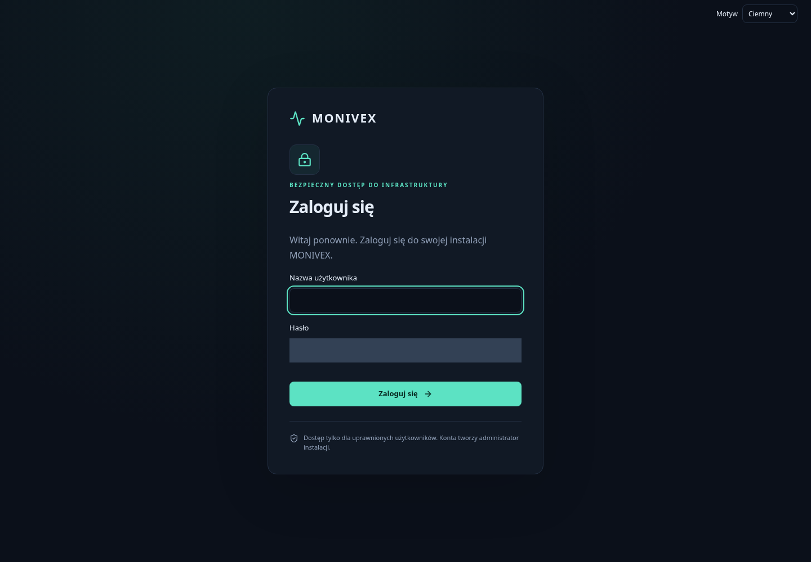
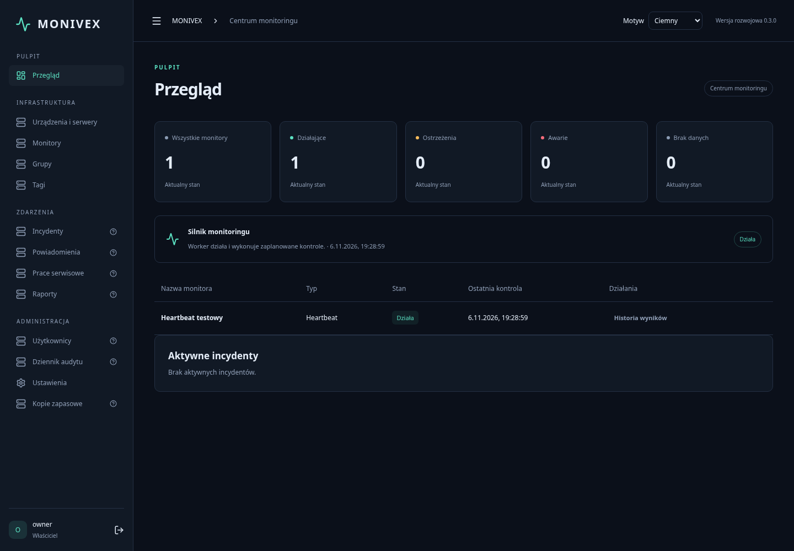
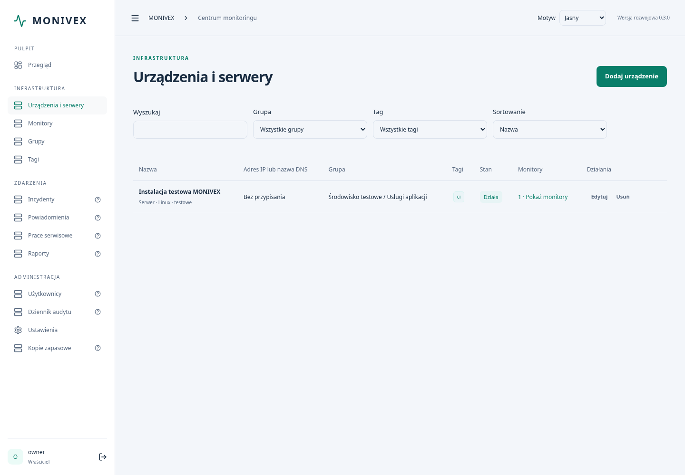

# MONIVEX

Polskojęzyczna, otwarta platforma self-hosted do monitorowania infrastruktury. Licencja Apache 2.0.

**Stan: 0.4.0 — wersja rozwojowa, przygotowana do przeglądu.** MONIVEX ma bezpieczną inicjalizację właściciela, sesje, polski panel, niezależny worker i rzeczywiste kontrole usług. Możesz zarządzać urządzeniami, hierarchią grup i tagami, konfigurować i edytować monitory, duplikować je oraz wykonywać operacje zbiorcze. Pulpit pokazuje faktyczne wyniki i wykrywa nieaktualność danych. Logowanie obsługuje opcjonalne TOTP, kody odzyskiwania, zarządzanie sesjami i własny dziennik bezpieczeństwa.

Obsługiwane kontrole: TCP, HTTP/HTTPS, DNS, certyfikaty TLS, SMTP/STARTTLS, HTTP JSON, heartbeat i ICMP (wymaga odpowiednich uprawnień kernela; lokalny runtime testowy go nie udostępniał). Kontrole sieciowe wymagają jawnej polityki CIDR. Powiadomienia, rozbudowane raporty i automatyczny backup pozostają kolejnymi etapami.

[Bezpieczeństwo konta i 2FA](docs/BEZPIECZENSTWO_KONTA.md) · [Profil VPS/HTTPS](docs/WDROZENIE_VPS.md) · [Zarządzanie infrastrukturą](docs/ZARZADZANIE_INFRASTRUKTURA.md) · [Silnik i bezpieczeństwo](docs/SILNIK_MONITORINGU.md) · [Testy i galeria Actions](docs/TESTY_I_ZRZUTY.md)

## Rzeczywisty interfejs

Nowy ekran logowania 0.4.0 (pole hasła zamaskowane):



[Zobacz rzeczywisty panel bezpieczeństwa konta](docs/images/account-security-0.4.png).

Poniżej działająca, jednorazowa instalacja testowa z prawdziwym heartbeat — bez podstawianych wyników. Więcej ekranów i raporty znajdują się w artefaktach GitHub Actions.





## Szybki start lokalny

Wymagany Docker Engine i Docker Compose v2 (profil HTTPS/testy: 2.24.4+); host nie potrzebuje Node ani Pythona.

```sh
cp .env.example .env
# Ustaw w .env własny losowy MONIVEX_SETUP_TOKEN (minimum 32 znaki).
# Dla lokalnego HTTP ustaw MONIVEX_COOKIE_SECURE=false.
# Dla 2FA ustaw trwały MONIVEX_ENCRYPTION_KEY zgodnie z .env.example.
# Ustaw MONIVEX_ALLOWED_NETWORKS na dozwolone CIDR albo zacznij od heartbeat.
docker compose up --build -d
docker compose ps
```

Otwórz panel na porcie 8080 lokalnego hosta. Przejdź kreator: powitanie → login, silne hasło i sekret wdrożenia → nazwa i strefa czasowa → informacja o opcjach → podsumowanie. Następnie zaloguj się. Sekret nie jest hasłem właściciela i nie pozwala powtórzyć zakończonej inicjalizacji.

Domyślnie port jest przypisany do loopback; dla LAN ustaw odpowiedni interfejs przez `MONIVEX_BIND_ADDRESS`, dokładny `MONIVEX_PUBLIC_ORIGIN` i reguły zapory. Zalecane HTTPS, także w LAN. Dla HTTPS pozostaw `MONIVEX_COOKIE_SECURE=true`. Nie wystawiaj niezabezpieczonego HTTP do internetu.

## Profil publiczny

Samodzielny `compose.public.yaml` zawiera Caddy z HTTPS i odseparowanym wolumenem danych. Nie jest nakładką na lokalny Compose. Procedurę przygotowania domeny, ochrony sekretów, migracji i aktualizacji opisuje [wdrożenie VPS](docs/WDROZENIE_VPS.md). Nie wykonano rzeczywistego wdrożenia.

## Dokumentacja

- [Raport MONIVEX 0.4.0](docs/RAPORT_0_4_0.md)
- [Bezpieczeństwo konta i 2FA](docs/BEZPIECZENSTWO_KONTA.md)
- [Przygotowanie VPS i HTTPS](docs/WDROZENIE_VPS.md)
- [Raport etapu 3](docs/RAPORT_ETAP_3.md)
- [Zarządzanie infrastrukturą](docs/ZARZADZANIE_INFRASTRUKTURA.md)
- [Testy i zrzuty ekranów](docs/TESTY_I_ZRZUTY.md)
- [Silnik monitoringu i polityka celów](docs/SILNIK_MONITORINGU.md)
- [Raport etapu 2](docs/RAPORT_ETAP_2.md)

- [Instalacja i reverse proxy](docs/INSTALACJA.md)
- [Administracja](docs/ADMINISTRACJA.md)
- [Architektura i plan etapów](docs/PLAN_IMPLEMENTACJI.md)
- [API](docs/API.md)
- [Raport i weryfikacja etapu 1](docs/RAPORT_ETAP_1.md)
- [Współpraca](CONTRIBUTING.md) · [Bezpieczeństwo](SECURITY.md) · [Zmiany](CHANGELOG.md)

## Testy i rozwój

```sh
cd backend
python3 -m venv .venv
.venv/bin/pip install -r requirements-dev.txt -c requirements.lock
.venv/bin/python -m pytest -q
.venv/bin/ruff check app tests migrations
cd ../frontend
npm ci
npm test
npm run lint
npm run build
```

Instrukcje startu bez Dockera: [Instalacja](docs/INSTALACJA.md). Nie wykonuj wdrożeń produkcyjnych bez osobnej weryfikacji. Nie dodawaj danych rzeczywistej infrastruktury, haseł, baz i tokenów do repozytorium.
